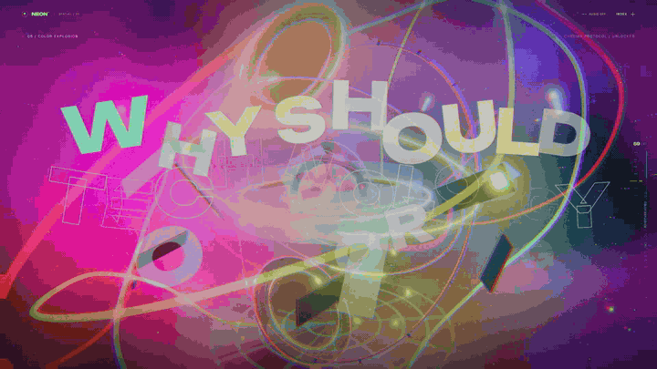
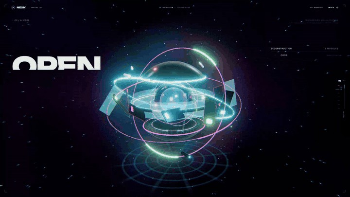
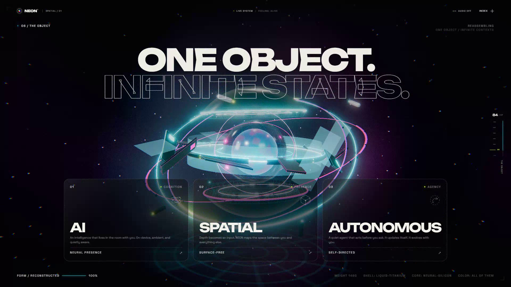

<div align="center">
  
</div>

<h1 align="center">NEON — The Next Interface</h1>

<h3 align="center">Technology should feel alive.</h3>

<p align="center">
  <sub>A speculative spatial AI product from 2026 — designed as a scroll-driven film, not a landing page.</sub>
</p>

<p align="center">
  <a href="recordings/neon-cinematic-16x9.mp4"></a>
  <a href="recordings/neon-cinematic-9x16.mp4"></a>
  <a href="https://github.com/AHMEDALIGHORI/neon-the-next-interface"></a>
</p>

<p align="center">
  <a href="https://github.com/AHMEDALIGHORI/neon-the-next-interface">github.com/AHMEDALIGHORI/neon-the-next-interface</a>
</p>

<p align="center">
  
  
  
  
  
  
</p>

<br />

<div align="center">
  <a href="recordings/neon-cinematic-16x9.mp4">
    
  </a>
  <br />
  <sub><b>NEON is an interactive film.</b> The scroll is the timeline. The 3D scene is the protagonist.</sub>
</div>

<br />

> **No template. No stock 3D. No shortcuts.**  
> Every surface, particle, ring, label, shader and transition is generated in code. The experience ships as a single procedural WebGL scene.

## The film

NEON is a fictional consumer device at the intersection of AI, spatial computing, wearables and robotics. The site follows its consciousness from darkness to full colour in seven chapters:

| Chapter | Title | The moment |
| :---: | :--- | :--- |
| **01** | **THE ARRIVAL** | A floating interface wakes up in the dark. |
| **02** | **AI CORE** | The shell explodes into five living systems. |
| **03** | **INTELLIGENCE** | Hardware becomes a neural particle organism. |
| **04** | **SPATIAL UI** | The camera flies through a corridor of glass panels. |
| **05** | **COLOR EXPLOSION** | The entire world breaks into chroma. |
| **06** | **THE OBJECT** | Everything reconstructs into the final product. |
| **07** | **THE FUTURE** | The camera pulls back. The interface stays with you. |

<div align="center">
  
  <br />
  <sub><b>02 / AI CORE</b> — procedural exploded architecture, annotated in 3D.</sub>
</div>

## The build

| Layer | What powers it |
| :--- | :--- |
| **Frame** | React 19 + Vite |
| **World** | Three.js — procedural hardware, orbital rings, shards, glass, particles |
| **Narrative** | One master GSAP timeline scrubbed by ScrollTrigger |
| **Motion** | Lenis smooth scroll + velocity-reactive camera choreography |
| **Light** | Bloom, chromatic aberration, film grain, vignette and custom GLSL skies |
| **Sound** | Optional, user-initiated Web Audio cues — silent by default |
| **Objects** | Instanced hardware details, capped DPR, reduced mobile particle counts |

<details>
<summary><b>Explore the architecture</b></summary>
<br />

```text
src/
├── three/
│   ├── Experience.js          # WebGL orchestra, lifecycle, scroll state
│   ├── NeonDevice.js          # Procedural device, explode & reform
│   ├── NeuralNetwork.js       # 5,200-node particle intelligence
│   ├── SpatialPanels.js       # 3D glass UI corridor + canvas interfaces
│   ├── ColorWorld.js          # Shader sky, chroma particles, fluid ribbons
│   ├── DeviceLabels.js        # Camera-space engineering annotations
│   └── PostProcessing.js      # Bloom, aberration, grain, grade
├── animations/
│   ├── scrollAnimations.js    # The seven-chapter master timeline
│   ├── cameraAnimation.js     # One continuous camera move
│   └── scrollSetup.js         # Lenis ↔ ScrollTrigger bridge
├── components/                # Seven cinematic sections + UI overlays
└── lib/                       # Motion state, cue bus, optional sound engine
```

</details>

## Run it

```bash
git clone https://github.com/AHMEDALIGHORI/neon-the-next-interface.git
cd neon-the-next-interface
npm install
npm run dev
```

Open **http://localhost:5173**.  
For a clean screen recording, use **`http://localhost:5173/?capture=1`** — full-resolution typography with a lighter WebGL pipeline.

## Details worth noticing

- **The device is entirely procedural** — no downloaded 3D assets, no 4K textures.
- **The 3D labels follow the hardware** as it explodes, drawn from live world positions.
- **Scroll is the edit.** One pinned timeline means transitions cannot drift apart.
- **The camera is choreographed**, not just tweened: push-in, orbit, fly-through, pull-back.
- **Mobile is a different cut**, not a squeezed desktop version.
- **Audio is opt-in.** Press `AUDIO` in the top bar. No autoplay. Ever.
- **All animation disposes cleanly** — geometry, materials, render targets and event listeners.

<div align="center">
  <a href="recordings/neon-cinematic-16x9.mp4">
    
  </a>
  <br />
  <sub><b>06 / THE OBJECT</b> — the final product, reconstructed from light.</sub>
</div>

<br />

<div align="center">
  <a href="https://github.com/AHMEDALIGHORI/neon-the-next-interface">
    
  </a>
</div>

<p align="center">
  <sub>NEON is a fictional product concept. Designed and engineered for the near future.</sub><br />
  <sub><b>NEON — 2026</b></sub>
</p>

<p align="center">
  <a href="https://github.com/deepseek-ai/deepseek-harness">
    
  </a>
</p>
